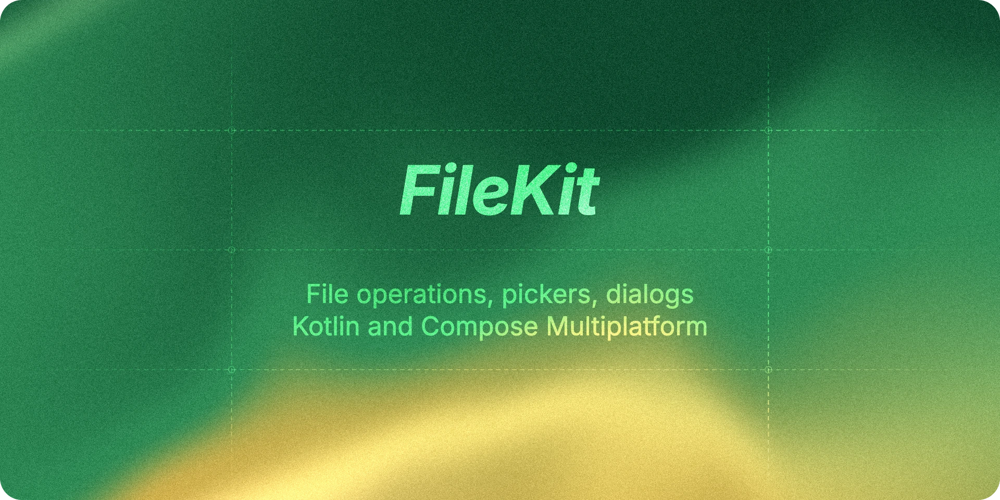

<div align="center">
  <a href="https://filekit.mintlify.app"></a>

  <p>
    <b>Pick, save, and work with files from shared Kotlin code,<br>with native dialogs on Android, iOS, and desktop, plus browser pickers on the web.</b>
  </p>

  <p>
    <a href="https://central.sonatype.com/artifact/io.github.vinceglb/filekit-core"></a>
    <a href="https://filekit.mintlify.app/platform-support"></a>
    <a href="LICENSE"></a>
    <a href="https://filekit.mintlify.app"></a>
  </p>

  <p>
    <a href="https://filekit.mintlify.app"><b>Documentation</b></a>
    &nbsp;·&nbsp;
    <a href="https://filekit.mintlify.app/quickstart"><b>Quickstart</b></a>
    &nbsp;·&nbsp;
    <a href="https://filekit.mintlify.app/live-demo"><b>Try it in your browser</b></a>
    &nbsp;·&nbsp;
    <a href="https://filekit.mintlify.app/roadmap"><b>Roadmap to 1.0</b></a>
  </p>
</div>

## Installation

Add FileKit to your shared module. For a Compose Multiplatform app, one artifact brings the dialogs, the Compose launchers, and the core file API:

```kotlin
// build.gradle.kts
kotlin {
    sourceSets {
        commonMain.dependencies {
            implementation("io.github.vinceglb:filekit-dialogs-compose:0.17.0")
        }
    }
}
```

Not using Compose, or targeting Linux native, Windows native, or watchOS? Use `filekit-dialogs`, or `filekit-core` for file operations only. The [platform support matrix](https://filekit.mintlify.app/platform-support#targets-per-module) shows which module runs where.

Most targets need no setup. On Android, call `FileKit.init(activity)` if you use the suspend dialog APIs; the Compose launchers work without it. On JVM desktop and Linux or Windows native, call `FileKit.init(appId)` before using app directories such as `FileKit.filesDir`. The [installation guide](https://filekit.mintlify.app/installation#platform-setup) covers the version catalog, every module, and each platform.

## At a glance

**Pick a file in Compose**

```kotlin
val launcher = rememberFilePickerLauncher(
    type = FileKitType.Image,
    onError = { failure -> println("Picker failed: ${failure.message}") },
) { image ->
    // A PlatformFile, or null if the user cancelled
}

Button(onClick = { launcher.launch() }) {
    Text("Pick an image")
}
```

**Pick files from any coroutine**

```kotlin
val files: List<PlatformFile>? = FileKit.openFilePicker(
    type = FileKitType.File("pdf", "docx"),
    mode = FileKitMode.Multiple(maxItems = 10),
)
```

**Save a file where the user chooses**

```kotlin
// From a coroutine
val file = FileKit.openFileSaver(suggestedName = "hello", defaultExtension = "txt")
file?.writeString("Hello FileKit!")
```

**Work with files**

```kotlin
// From a coroutine
val notes = FileKit.filesDir / "notes.txt"
notes.writeString("Hello FileKit!")

println("${notes.name}: ${notes.size()} bytes")
notes.copyTo(FileKit.cacheDir / "notes-backup.txt")
```

The file saver, app directories, and path operations such as `/` and `copyTo` aren't available on JS and Wasm. Call them from a [non-web source set](https://filekit.mintlify.app/platform-support#use-platform-specific-apis-from-shared-code), and use `FileKit.download` in the browser.

The [quickstart](https://filekit.mintlify.app/quickstart) walks through a full pick, read, and save round trip in a few minutes.

## Modules

| Module | Use it for |
| --- | --- |
| `filekit-core` | `PlatformFile` and file operations (read, write, copy, move, list), app directories, image compression |
| `filekit-dialogs` | Native file, directory, gallery, and camera pickers and save dialogs, callable from any coroutine |
| `filekit-dialogs-compose` | Compose Multiplatform launchers such as `rememberFilePickerLauncher`, plus `ImageBitmap` helpers |
| `filekit-coil` | Display a `PlatformFile` with Coil 3's `AsyncImage` |

`filekit-dialogs-compose` includes `filekit-dialogs`, which includes `filekit-core`.

## Platform support

| Module | Android | iOS | macOS | JVM desktop | Linux | Windows | watchOS | Web |
| --- | :-: | :-: | :-: | :-: | :-: | :-: | :-: | :-: |
| `filekit-core` | ✅ | ✅ | ✅ | ✅ | ✅ | ✅ | ✅ | ✅ |
| `filekit-dialogs` | ✅ | ✅ | ✅ | ✅ | ✅ | ✅ | ❌ | ✅ |
| `filekit-dialogs-compose` | ✅ | ✅ | ✅ | ✅ | ❌ | ❌ | ❌ | ✅ |
| `filekit-coil` | ✅ | ✅ | ✅ | ✅ | ❌ | ❌ | ❌ | ✅ |

JVM desktop runs on Windows, macOS, and Linux. The Linux and Windows columns are Kotlin/Native targets, and Web covers JS and Wasm. Some features depend on the platform (browsers don't let you choose a save location, so FileKit offers `FileKit.download` there). The [platform support matrix](https://filekit.mintlify.app/platform-support) lists every feature per target.

## Who's using FileKit

FileKit is used by [Thunderbird](https://github.com/thunderbird/thunderbird-android), [Leboncoin's Spark design system](https://github.com/leboncoin/spark-android), [Gradle Client](https://github.com/gradle/gradle-client), [Blockstream Green](https://github.com/Blockstream/green_android), [Square's Workflow trace viewer](https://github.com/square/workflow-kotlin), the [Android FHIR SDK](https://github.com/ohs-foundation/android-fhir), [Animeko](https://github.com/open-ani/animeko), and [StreetComplete](https://github.com/streetcomplete/StreetComplete).

See how each project uses it in the [showcase](https://filekit.mintlify.app/showcase), read what developers say on the [wall of love](https://filekit.mintlify.app/wall-of-love), or [add your project](https://github.com/vinceglb/FileKit/discussions/343).

## Contributing

Bug reports, documentation fixes, and pull requests are welcome. [CONTRIBUTING.md](CONTRIBUTING.md) explains how to set up the project and which checks to run. For questions and ideas, open a [discussion](https://github.com/vinceglb/FileKit/discussions).

## Credits

FileKit stands on the shoulders of giants. Special thanks to:

- [compose-multiplatform-file-picker](https://github.com/Wavesonics/compose-multiplatform-file-picker)
- [peekaboo](https://github.com/onseok/peekaboo)
- [Calf](https://github.com/MohamedRejeb/Calf)
- [jnafilechooser](https://github.com/steos/jnafilechooser)
- [swing-jnafilechooser](https://github.com/DJ-Raven/swing-jnafilechooser)
- [nativefiledialog](https://github.com/mlabbe/nativefiledialog)
- [IFileDialogImp](https://github.com/dbwiddis/IFileDialogImp)
- [IntelliJ Community Foundation](https://github.com/JetBrains/intellij-community/blob/master/platform/util/ui/src/com/intellij/ui/mac/foundation/Foundation.java)
- [file_picker (flutter)](https://pub.dev/packages/file_picker)

## License

FileKit is released under the [MIT License](LICENSE).

---

<div align="center">
  <p>Made with ❤️ by <a href="https://github.com/vinceglb">Vince</a></p>
</div>
