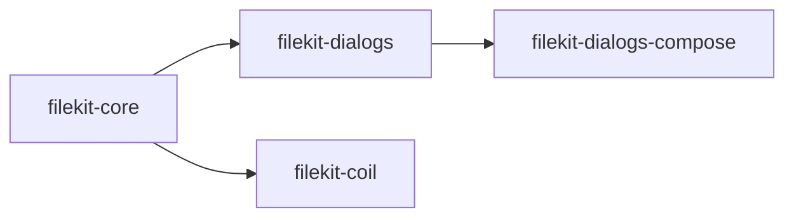

import { QuoteGrid, QuoteCard } from '/snippets/quote-card.jsx'


**FileKit is the file layer for Kotlin Multiplatform.** Open native file, photo, directory, and camera pickers, save and share files, and read or write them through a single `PlatformFile` type. The same code runs on Android, iOS, macOS, desktop JVM (Windows, macOS, Linux), Linux and Windows native, JS, and Wasm, and FileKit Core also runs on watchOS.

## FileKit in 30 seconds

Let the user pick a photo, then show it or read its bytes.

<CodeGroup>

```kotlin Compose
@Composable
fun PhotoPicker() {
    val scope = rememberCoroutineScope()
    var photo by remember { mutableStateOf<ImageBitmap?>(null) }

    val launcher = rememberFilePickerLauncher(
        type = FileKitType.Image,
        onError = { failure -> println("Picker failed: ${failure.message}") },
    ) { file ->
        // null when the user cancels
        if (file != null) scope.launch { photo = file.toImageBitmap() }
    }

    Button(onClick = { launcher.launch() }) { Text("Pick a photo") }
    photo?.let { Image(bitmap = it, contentDescription = null) }
}
```

```kotlin Suspend API
suspend fun importPhoto() {
    // Native picker on every platform; null when the user cancels
    val photo = FileKit.openFilePicker(type = FileKitType.Image) ?: return

    println("${photo.name}: ${photo.size()} bytes")

    // Read it, then upload it or store it
    val bytes: ByteArray = photo.readBytes()
}
```

</CodeGroup>

<CardGroup cols={2}>
  <Card title="Try it in your browser" icon="play" href="/live-demo">
    Run the FileKit sample app live, with no install.
  </Card>
  <Card title="Run it in two minutes" icon="rocket" href="/quickstart">
    Add one dependency, do the per-platform setup, and pick your first file.
  </Card>
</CardGroup>

## What you can build

<CardGroup cols={2}>
  <Card title="Photo and file uploads" icon="cloud-arrow-up" href="/dialogs/file-picker">
    Open the native file picker or the Android and iOS photo picker, then read the bytes to upload them.
  </Card>
  <Card title="Export and save documents" icon="floppy-disk" href="/dialogs/file-saver">
    Ask the user where to save a file, then write text, bytes, or a stream to it.
  </Card>
  <Card title="Work with project folders" icon="folder-open" href="/dialogs/directory-picker">
    Let users pick a folder, then list, walk, and copy its contents. Keep access across launches with bookmarks.
  </Card>
  <Card title="Camera capture and photo processing" icon="camera" href="/dialogs/camera-picker">
    Take a photo, compress or resize it, and save it to the user's gallery.
  </Card>
  <Card title="Share and open files" icon="share-nodes" href="/dialogs/share-file">
    Send a file to the system share sheet or open it in the default app.
  </Card>
  <Card title="Local app storage" icon="hard-drive" href="/core/file-utils">
    Store files in the app's files, cache, and databases directories. The same paths work with DataStore or Room.
  </Card>
</CardGroup>

## Platforms

| Android | iOS | macOS | JVM desktop | Linux native | Windows native | JS | Wasm | watchOS |
| :-----: | :-: | :---: | :---------: | :----------: | :------------: | :-: | :--: | :-----: |
| ✅ | ✅ | ✅ | ✅ | ✅ | ✅ | ✅ | ✅ | Core only |

Every target with `filekit-dialogs` uses the platform's native dialogs (watchOS has FileKit Core only). Some features are platform-specific: the camera and share sheet are mobile-only, the file saver is not available in browsers, and Compose and Coil support follows Compose Multiplatform's targets. See the [platform support matrix](/platform-support) for a feature-by-feature breakdown.

## Modules

Add only the modules you need. Each module pulls in the ones it builds on.

| Artifact | What it gives you | Add it when |
| --- | --- | --- |
| `filekit-core` | `PlatformFile`, reading and writing, file system operations, app directories, image utilities, bookmarks | You work with files and don't need dialogs |
| `filekit-dialogs` | Native file, gallery, directory, and camera pickers, plus the file saver, share, and open-file dialogs, as `suspend` functions | You open dialogs from shared code, ViewModels, or non-Compose UI |
| `filekit-dialogs-compose` | `remember…Launcher` APIs and `PlatformFile.toImageBitmap()` | Your UI uses Compose Multiplatform |
| `filekit-coil` | `PlatformFile` support in Coil 3 `AsyncImage` | You display images with Coil |



## Next steps

<CardGroup cols={2}>
  <Card title="Quickstart" icon="rocket" href="/quickstart">
    Pick and read your first file.
  </Card>
  <Card title="Installation" icon="download" href="/installation">
    Dependencies and per-platform setup.
  </Card>
  <Card title="Platform support" icon="table-cells" href="/platform-support">
    See which features each platform supports.
  </Card>
  <Card title="Use FileKit with AI assistants" icon="robot" href="/ai-assistants">
    Give your coding assistant the FileKit docs through MCP, `llms.txt`, or Markdown.
  </Card>
</CardGroup>

## Who uses FileKit

FileKit is used by [Thunderbird](https://github.com/thunderbird/thunderbird-android), [Leboncoin's Spark design system](https://github.com/leboncoin/spark-android), [Gradle Client](https://github.com/gradle/gradle-client), [Blockstream Green](https://github.com/Blockstream/green_android), [Animeko](https://github.com/open-ani/animeko), [StreetComplete](https://github.com/streetcomplete/StreetComplete), and many more. The [showcase](/showcase) says how each project uses it.

<QuoteGrid>
  <QuoteCard
    quote="The API just makes sense and I can just focus on my app instead of fighting with platform APIs"
    name="Alex Styl"
    role="Composables"
    handle="@alexstyl"
    platform="X"
    date="Jun 2, 2025"
    href="https://x.com/alexstyl/status/1929504630490239214"
  />
  <QuoteCard
    quote="You literally saved me hours and hours of time 👍"
    name="Simon Schubert"
    role="Kai"
    handle="@SimonSchubert"
    platform="GitHub"
    date="Mar 15, 2026"
    href="https://github.com/vinceglb/FileKit/discussions/343#discussioncomment-16142366"
  />
  <QuoteCard
    quote="[...] your documentation is outstanding. Finally a human friendly documentation 😅"
    name="Pavlos Tzegiannakis"
    role="Tracker for Bluesky"
    handle="@PavlosTze"
    platform="GitHub"
    date="Mar 18, 2025"
    href="https://github.com/vinceglb/FileKit/issues/215#issuecomment-2734341542"
  />
</QuoteGrid>

[Read more on the wall of love →](/wall-of-love)

Browse the [sample apps](https://github.com/vinceglb/FileKit/tree/main/sample) to see FileKit running on each platform.
